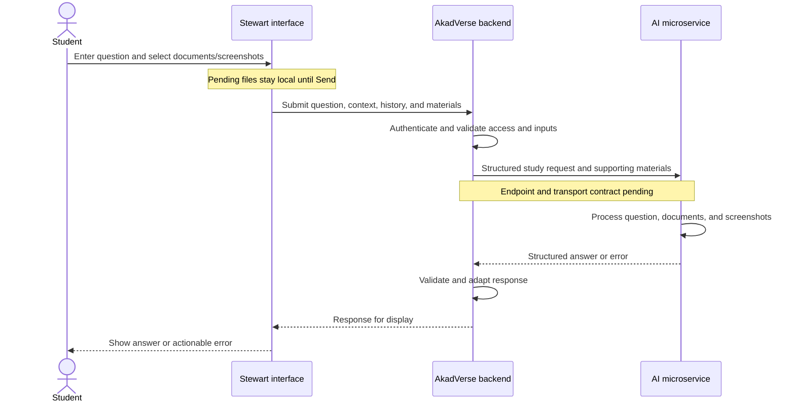

# Stewart — AkadVerse’s Study Assistant Interface

> **11 November 2026:** Saved conversations, messages, independent sessions, retry safety, history selection and the simple welcome state are now implemented. See [persistent conversation contracts and rollout](stewart-conversations.md). Unsent drafts and unuploaded files still live only in the current browser visit.

> **10 November 2026 implementation update:** Documents and screenshots now share the Concept Explainer attachment/explain workflow, with persisted ownership and server-scoped sessions. See [the current attachment contract and rollout guide](stewart-attachments.md). Earlier direct-provider and unsupported-attachment descriptions below are historical.

> Architecture clarification, 5 November 2026: this document describes Stewart’s intended role and integration with an external AI microservice. The question-answering endpoint is still being developed, and its contract has not been supplied. The repository’s current direct Anthropic integration is an implementation mismatch to be replaced; it is not the architecture specified here.

## 1. What Stewart is

**Stewart is the student-facing study assistant inside AkadVerse’s E-Learning Study Zone.** It provides the interface through which students ask questions about course topics, attach supporting documents, capture screenshots, and read answers returned by an AI microservice.

Stewart and the AkadVerse backend collect and prepare the information needed for a study request. The external AI microservice processes the question and supporting materials and generates the answer. Stewart processes the returned response for presentation in the conversation.

The responsibilities are:

| Component | Responsibility |
| --- | --- |
| Stewart interface | Collect questions, manage conversation state, accept documents and screenshots, show progress, and display responses or errors. |
| AkadVerse backend | Authenticate students, verify course access, validate inputs, prepare structured requests, communicate with the microservice, and adapt responses for the interface. |
| AI microservice | Handle questions and their supporting documents/screenshots, perform the AI processing, and return structured answers. |

The AI provider, model, document-processing strategy, and answer-generation logic belong to the microservice. Stewart’s intended integration does not require AkadVerse to call Anthropic directly.

## 2. Purpose and student experience

Stewart keeps studying and asking questions in the same workspace. Students can read a course document and ask for help without leaving Study Zone.

The intended experience supports requests such as:

| Study activity | Example |
| --- | --- |
| Understand a concept | “Explain recursion with a simple example.” |
| Summarise material | “Summarise the lecture notes I attached.” |
| Explain terminology | “Explain the key terms in these slides.” |
| Work through a problem | “Explain how to solve this equation step by step.” |
| Understand a diagram | “What does this part of the screenshot mean?” |
| Connect sources | “Use the attached notes to explain this chart.” |
| Practise a topic | “Ask me practice questions about this topic.” |

Stewart provides the interaction and presentation for these requests. The quality and supported scope of the answers depend on the microservice’s implementation. Conversational practice questions do not create official assessments or assessment records.

## 3. Where Stewart lives

Students access Stewart through:

- `/e-learning/student/study-zone` — course selection.
- `/e-learning/student/study-zone/[courseId]` — a course’s study workspace.

The workspace combines course/week selection, the selected document’s viewer, and the Stewart conversation panel. Its layout accommodates both desktop and smaller screens.

The existing access rules require a signed-in student with an E-Learning profile. Course workspace and chat access are checked against the student’s approved registration for the current academic session and semester. These checks should remain in the AkadVerse backend when answer generation moves to the microservice.

## 4. Intended request and response flow

This is the logical flow. It does not prescribe whether files travel in the same request as the question, are uploaded beforehand, or are represented by service-issued references. Those details must follow the microservice’s final contract.

### Collect the student’s input

Stewart gathers the question and any files the student has chosen. The workspace supplies the selected course, week, and document identifiers. Recent conversation turns can provide context for follow-up questions.

Students should be able to review and remove pending files before submission. Selecting a file or taking a screenshot does not by itself send a question to the microservice.

### Validate and prepare the request

The AkadVerse backend checks the student’s identity, course access, message shape, and file constraints. It resolves authoritative course information on the server rather than trusting course names supplied by the browser.

It then prepares a structured request for the microservice. The expected information categories are:

- The student’s question.
- Relevant conversation context.
- Authorized course and study context.
- Attached documents and screenshots, or references to them according to the agreed transport.

These categories describe the intended information flow. Exact field names, required fields, identity handling, and serialization have not been agreed yet. Internal account identifiers should only be forwarded if the contract requires them.

### Process the question in the microservice

The microservice handles the submitted question and supporting material. It owns the AI-side decisions, including how to read documents, interpret screenshots, use conversation context, retrieve information where applicable, and generate an answer.

This document does not select an AI provider or assume that the service uses a particular model, embeddings pipeline, vector database, or retrieval strategy.

### Process and display the response

The AkadVerse backend receives the microservice’s structured response, validates it against the eventual contract, and maps it into a response the Stewart interface can use.

Stewart displays the answer and any supported supplementary information. Whether that response contains citations, warnings, formatted blocks, attachment metadata, or other fields remains to be agreed. The response format and rendering behavior must be implemented together once the contract is available.

## 5. Documents and screenshots

Documents and screenshots are inputs to the microservice’s question-answering process. Stewart provides the controls for selecting and reviewing those inputs.

### Documents

Students can use the attachment control to choose supporting files and ask questions about them. The current interface supports PDF, Word, PowerPoint, plain text, Markdown, and common image files.

The final set of supported types and processing limits must be checked against the microservice contract. Existing local support does not establish that the new endpoint can process every format.

### Screenshots

The existing viewer provides a Capture control for selecting a region of a displayed document. A captured region becomes a pending PNG attachment, which the student can review, remove, or retake before sending.

This is useful for equations, diagrams, charts, tables, and specific passages. Screenshots should be sent to the microservice as visual material through the agreed file transport.

The capture reflects what the viewer rendered. Image clarity and Office rendering fidelity can therefore affect the material available for answering.

### Viewing versus attaching

Opening a document in the viewer currently does not automatically include its contents in a chat request. The selected document identifier/title provides study context; it does not itself supply readable content.

Students currently need to attach the file or capture the relevant region for content-specific help. Any future ability to answer directly from previously ingested course documents requires an explicit microservice contract for document identification and authorized access.

## 6. Existing interface behavior to retain

The current Stewart interface already provides useful interaction behavior:

- Separate conversations for the selected week/document during the page visit.
- Question drafts and pending files associated with their conversation.
- Suggested prompts such as summarising material, explaining terms, and practising a topic.
- Enter to send and Shift+Enter for a new line.
- Pending-file review, removal, and screenshot retake.
- Progress states while preparing files or waiting for an answer.
- Recovery of the question and pending files after a failed send.
- Local greetings and error notices excluded from the conversation sent for inference.

The current implementation also caches successful uploads during retries and keeps submitted file references for follow-up questions. Those behaviors need adapting to the microservice’s file-reference and expiry rules rather than assuming the current provider’s lifecycle applies.

Conversations currently live in React component state and are not restored after reloading or leaving the workspace. Persistent conversation storage is a separate feature and is not established by the pending microservice integration.

## 7. Existing limits versus the pending contract

These values are implemented in the current code. They are useful integration constraints, but they do not define the unfinished microservice’s capabilities.

| Existing AkadVerse setting | Current value |
| --- | --- |
| File formats accepted by the interface | PDF, DOC/DOCX, PPT/PPTX, TXT/MD, PNG, JPG/JPEG, WebP |
| Attachment allowance | Up to 8 references per conversation/chat request |
| Original file size | Up to 4 MiB per file; shown as 4 MB in the interface |
| Student message length | Up to 4,000 characters |
| History submitted for current model calls | At most 24 recent messages, trimmed to begin with a student turn |
| Current extracted-text cap | 300,000 characters per extracted file |
| Current chat rate limit | 20 requests per user per 5 minutes, per server instance |
| Current upload rate limit | 10 uploads per user per 10 minutes, per server instance |

The current six-hour provider-file expiry, signed provider-file handles, prompt caching, model output budget, and Anthropic-specific configuration belong to the existing direct integration. They must not be treated as requirements or guarantees for the future microservice endpoint.

The final integration must reconcile application limits with service limits and hosting constraints. The current process-local rate limiter does not provide a distributed quota or a global spending cap.

## 8. Security responsibilities

AkadVerse remains responsible for enforcing application access before forwarding requests. The microservice connection must preserve that boundary.

The intended integration should:

- Authenticate the student and verify access to the requested course.
- Validate questions, conversation data, and attachment constraints on the server.
- Keep microservice credentials on the backend.
- Resolve authoritative academic context from server-side data.
- Send only the information needed to answer the study request.
- Treat document contents and screenshots as untrusted study material.
- Validate returned data before rendering it.
- Show useful errors without exposing credentials or internal service details.

Authentication between AkadVerse and the question-answering endpoint, file ownership, attachment retention, cleanup, and any asynchronous callback verification remain contract decisions. Existing ingestion authentication does not automatically define the question-answering endpoint’s authentication.

Stewart’s study-assistant role does not grant access to grades, other students’ records, or account-management actions.

## 9. Relationship to the existing ingestion microservice

AkadVerse already has a separate course-material ingestion integration. It sends course documents and metadata to the AI microservice and receives processing-status callbacks.

The existing ingestion contract includes:

| Operation | Purpose |
| --- | --- |
| `POST /ingest` | Submit a course document for processing. |
| `DELETE /documents/{id}` | Request removal of a processed document. |
| `POST /api/webhooks/ai-ingest` on AkadVerse | Receive ingestion success/failure status from the microservice. |

An ingestion callback updates the material’s processing status and related task information. It is not a student’s answer-generation response.

The lecturer-facing material badge can show “AI: ready” or “AI: failed” after the page is refreshed or revisited. The callback currently does not send lecturer notifications or trigger a live UI update.

The existing ingestion endpoint does not establish a question-answering endpoint. How Stewart uses already-ingested material alongside newly attached documents/screenshots remains to be specified by the AI service engineer.

See [AI ingestion contract](ai-ingestion-contract.md) for the existing ingestion integration.

## 10. Current implementation mismatch

The current repository’s Stewart chat backend directly uses the Anthropic SDK. It builds model prompts, uploads prepared attachments to Anthropic’s Files API, and calls Claude to generate responses.

That code explains the current runtime behavior, but it does not match the architecture clarified in this document.

| Area | Current implementation | Intended implementation |
| --- | --- | --- |
| Answer generation | AkadVerse calls Anthropic directly. | AkadVerse forwards a structured request to the AI microservice. |
| Document/image handling for answers | AkadVerse prepares files and stores them through Anthropic. | The microservice handles supporting material through its agreed contract. |
| Provider/model configuration | AkadVerse contains Anthropic key/model settings. | Provider/model choices are owned by the microservice. |
| Response handling | AkadVerse extracts provider text and returns a reply. | AkadVerse validates and adapts the microservice’s structured response. |
| File references and lifetime | Provider-file IDs, signed handles, and six-hour expiry. | To follow the microservice’s ownership and lifecycle rules. |

This documentation update does not replace that code. The runtime migration remains pending until the question-answering contract is supplied.

## 11. What is still needed from the microservice

The endpoint is a work in progress. Implementation requires agreement on:

1. **Endpoint and method:** where study questions are submitted.
2. **Authentication:** how AkadVerse authenticates to the service.
3. **Request schema:** question, conversation, academic context, and required identifiers.
4. **Attachment transport:** multipart files, prior uploads, file references, or another agreed mechanism.
5. **Supported materials:** formats, size/count limits, and handling of screenshots and existing ingested documents.
6. **Response schema:** answer content and any citations, warnings, or metadata.
7. **Execution model:** synchronous response, streaming, or asynchronous jobs/callbacks.
8. **Error contract:** validation, unavailable service, unsupported files, rate limits, and retryable failures.
9. **File lifecycle:** retention, ownership, expiry, deletion, and follow-up reuse.
10. **Operational behavior:** timeouts, retry/idempotency rules, and service limits.

No URL, payload field names, answer-response schema, or new environment variable names are prescribed here. Those must be taken from the supplied contract.

## 12. Implementation areas affected by the migration

Paths below are relative to the repository root.

| Area | Relevant source | Integration work |
| --- | --- | --- |
| Chat UI | `src/app/e-learning/student/study-zone/_components/StewartPanel.tsx` | Retain interaction behavior and adapt response/attachment handling as needed. |
| Browser API client | `src/app/e-learning/student/study-zone/_components/stewart.ts` | Align browser-facing data with the backend’s revised contract. |
| Workspace and capture | `StudyWorkspace.tsx`, `DocumentViewer.tsx`, `capture-region.ts`, and `viewers/PdfViewer.tsx` in the same components directory | Preserve study context and document/screenshot collection. |
| Application chat endpoint | `src/app/api/e-learning/stewart/chat/route.ts` | Preserve authorization and forward validated study requests through the service layer. |
| Application attachment endpoint | `src/app/api/e-learning/stewart/attachments/route.ts` | Adapt or replace according to the agreed file transport. |
| Answer service | `services/e-learning/student/stewart/chat.ts` | Replace direct model request construction/calls with microservice request and response adaptation. |
| Provider client | `services/e-learning/student/stewart/client.ts` | Replace the direct Anthropic integration with the agreed service client. |
| Attachment services | `upload-attachment.ts`, `attachment-token.ts`, and extraction helpers under `services/e-learning/student/stewart/` | Review against the microservice’s file-processing and lifecycle responsibilities. |
| Shared constraints | `src/lib/stewart/config.ts` | Align supported inputs and limits with the final contract. |
| Existing ingestion client | `services/e-learning/ai-ingest/client.ts` | Keep ingestion responsibilities clear; reuse connection configuration only where the agreed contract supports it. |
| Tests | `tests/elearning/stewart-document-chat.test.ts`, `tests/elearning/stewart-http.test.ts`, and capture verification resources | Replace direct-provider assumptions and verify structured service requests/responses. |

Existing direct-provider tests do not establish compatibility with the unfinished endpoint. Once the contract is available, validation should cover authorization, mixed document/screenshot requests, response mapping, follow-up context, and failure/retry behavior.

## 13. Related documentation

- [AI ingestion contract](ai-ingestion-contract.md) — the existing document-ingestion and callback integration.
- [Stewart screenshots and supporting files](stewart-attachments.md) — current capture/attachment implementation; provider-specific details describe the pre-migration code.
- [Study Zone system](study-zone-system.md) — workspace layout and historical design.
- [Course materials system](course-materials-system.md) — course-document storage and access.
- [Implementation changelog](../../AKADVERSE_IMPLEMENTATION_CHANGELOG.md) — historical changes, including the direct-provider implementation.
