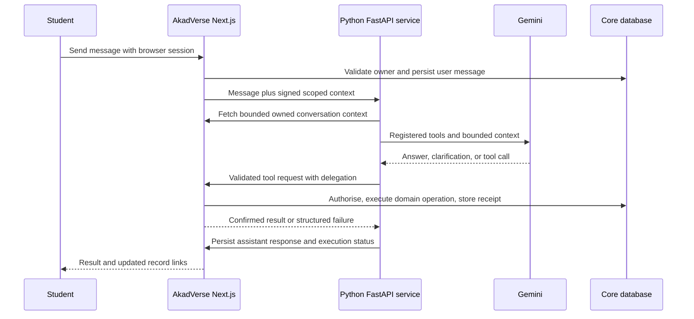

# AkadVerse Productivity AI Assistant: Stage 1 codebase audit

**Reviewed:** 15 November 2026.  
**Scope:** the local `productivity-layer-integration` branch and the supplied “Comprehensive Codebase Audit, Architecture, and Implementation Specification”.  
**Stage:** audit and recommended architecture. No assistant implementation, migration, deployment, or credential verification is included in this delivery.

> Historical Stage 1 snapshot: the implementation was approved afterward. See the [implementation plan](productivity-ai-implementation-plan.md), [service README](../akadverse-productivity-ai/README.md), and [verification report](productivity-ai-verification.md) for the resulting code and current status. Configuration absence and archived-only voice statements below describe the pre-implementation state.

## 1. Executive findings

The existing Productivity Layer is a substantial backend-owned personal planning system. It supports ordinary tasks, recurring task/event habits, personal events and categories, official timetable reads, account timezone preferences, and task/schedule analytics. It already enforces student ownership and preserves mutation receipts. An assistant should adapt these services rather than rebuild their rules in Python.

There is one current HTTP entry point, **POST `/api/productivity`**, with named operations. There are no separate REST CRUD routes for tasks, habits, or events. It requires a NextAuth browser session; a Python service cannot authenticate to it merely by supplying a user ID or an API key.

No Productivity AI conversation, message, tool-execution, or pending-confirmation tables exist. The existing E-Learning chat models serve another domain. New assistant persistence should belong to the Core database and be accessed through AkadVerse services.

The AssemblyAI implementation expected by the specification is **not active on this branch**. Its files are preserved in an ignored local branch-work archive. Reusing it requires deliberate restoration and an authentication-policy adaptation; simply importing the archived component would not provide a working deployed feature.

The supplied Gemini credential has not been written to a file, logged, committed, or tested against a provider. Local configuration inspection found no `GEMINI_API_KEY` or `GOOGLE_API_KEY`. Receiving a credential in chat does not establish that a running service has it configured.

The main design risks are delegated service authentication, duplicate writes after timeouts, confirmation authority, habit-source ownership, ambiguous dates, and persistence of a tool result when its mutation succeeds but conversation recording fails. These need explicit contracts before implementation.

For a nontechnical explanation and manual acceptance cases, see the [user and testing guide](productivity-layer-user-and-testing-guide.md).

## 2. Audit method and limits

This report is based on source inspection of routes, services, domain rules, models, UI, existing test scripts, and the preserved speech implementation. Configuration inspection was limited to variable presence; values are intentionally omitted.

This is not a live Gemini test, deployment audit, remote database inventory, penetration test, or rerun of application acceptance tests. Local source and environment findings do not establish the state of Vercel, Railway, Supabase, or the branch currently deployed to staging. Earlier test results elsewhere in the project are not reclassified as verification of this proposed assistant.

The supplied specification's section 16 requires: “Deliver the audit report, endpoint inventory, database findings, AssemblyAI findings, and recommended architecture” and “Do not make substantial changes yet.” Its final instruction explicitly says to present Stage 1 before substantial implementation. This report follows that gate. Proposed names and routes below are labelled proposals, not existing interfaces.

## 3. Frontend findings

### 3.1 Structure and navigation

The page lives at [the student Productivity Layer route](../src/app/studashboard/productivity-layer/page.tsx). Its layout supplies the feature stylesheet and host wrapper. The page resolves a real student account before mounting [ProductivityClient](../src/features/productivity/ProductivityClient.tsx).

The client maintains a per-account read cache and unmounts the workspace when the session changes. It prevents an expected-account mismatch from continuing requests. Setup failures can pause automatic loading, with dedicated failure UI rather than fabricated empty data.

[Workspace](../src/features/productivity/workspace/Workspace.tsx) manages Today, To-do List, Schedule Manager, and Habit Tracker. Visited sections stay mounted but hidden/inert to preserve view state; inactive timers are paused. Initial workspace data is batched, with section loading as a fallback. Official timetable reads are separable from personal data.

[Navigation](../src/features/productivity/workspace/navigation.ts) uses fragments such as `#tasks?task=<id>`, `#schedule?event=<id>&date=YYYY-MM-DD`, and `#habits?habit=<id>&date=YYYY-MM-DD&edit=true`. A confirmed assistant result can eventually deep-link into these existing views.

### 3.2 Existing product capabilities

| Surface | Existing behaviour | Assistant implication |
| --- | --- | --- |
| Today | Bounded task preview, daily habits, combined schedule, explicit focus choices, per-source failure handling | Build summaries from current backend reads, not conversation recollection. |
| To-do List | Create/edit unfinished ordinary tasks; delete; complete; record eligible misses; sorting, pagination, recorded history | Distinguish stored unfinished state from visible Active/Pending. No ordinary-task reopen tool. |
| Habit Tracker | Daily/weekday rules, task/event types, revisions, occurrence outcomes/corrections, archive/restore, event replanning | Use original habit/date identity; do not mutate projections as unrelated personal records. |
| Schedule Manager | Personal categories/events, day/week timetable, explicit focus, conflicts, backups, archive/restore, history | Source and owner must be derived by backend; conflict override requires trusted confirmation. |
| Official classes | Approved timetable/registration-derived reads and personal catch-up planning | Read-only classes; catch-up creates a separate personal event. |
| Analytics | Task/schedule panels and habit feedback | Explain cohort, deadline, planned-hour, and explicit-history semantics accurately. |
| Account settings | Timezone preference and signed-in identity | Dates must use verified account timezone and trusted current time. |
| Save notifications | Shared pending/success/error lifecycle, retry identity, accessible portal | Reuse feedback patterns; never show tool selection as completed work. |

The UI has no reminder delivery system, general collaborative planning, or autonomous AI planner. “Remind me tomorrow” must be clarified: saving a due-dated task does not create a push/email reminder.

A personal event completion method exists in domain code, but there is no registered `schedule.complete` operation and no general personal-event completion/miss button in the current Schedule Manager. `schedule.miss` is registered backend functionality. An assistant may expose it only with an explicit design decision and the existing elapsed-end guard.

A “Needs review” habit presentation state exists, but [the current outcome function](../src/features/productivity/habits/domain.ts) never returns `review`. Automatic review-credit handling is therefore not an established working capability. Resolve or explicitly defer this mismatch before promising that workflow.

### 3.3 UI conventions and integration point

The feature uses its own stylesheet, native dialogs, accessible chart alternatives, a collapsible desktop sidebar, and mobile navigation. Framer Motion is already a dependency, but the Productivity Layer does not need a new animation framework to add a panel.

Recommended placement is an account-scoped assistant host inside [WorkspaceShell](../src/features/productivity/workspace/WorkspaceShell.tsx), outside individual section contents. The panel can survive section changes and minimisation while being destroyed on account change. Persistent history must still come from the backend, not component lifetime or browser storage.

Native dialogs occupy the browser's top layer. A floating panel's z-index alone cannot put it over an open dialog. Define whether chat closes/minimises during form dialogs, or use an accessible coordinated overlay pattern. Follow the existing save-notification portal approach where appropriate. Reserve mobile space so the assistant button cannot cover Save, navigation, or timetable controls.

Use a follow-latest scroll policy: automatically follow only while the student is near the latest message; show a new-message affordance when they are reading older content. Respect reduced motion and keyboard focus, and retain an explicit Send action for transcribed text.

## 4. Current HTTP contract and authentication

### 4.1 Browser RPC

Source: [route](../src/app/api/productivity/route.ts), [validation](../services/productivity-layer/validation.ts), [dispatcher](../services/productivity-layer/operations.ts), [types](../services/productivity-layer/types.ts).

```http
POST /api/productivity
Content-Type: application/json
```

```json
{
  "operation": "tasks.create",
  "args": [{
    "title": "Finish chemistry assignment",
    "description": "Review questions 1 to 5",
    "priority": "medium"
  }],
  "requestId": "example-request-0001"
}
```

This is an illustration of an existing browser-session request, not a newly callable Python interface. A valid request requires the authenticated cookie session. An optional `x-productivity-user` header detects a stale expected account; it is **not** authentication or delegation.

The command accepts at most five positional arguments. Receipted mutations require an 8–200 character identifier using letters, digits, colon, or hyphen. Streamed body size is limited to 2 MiB. An oversized request currently returns a validation error (400), not a dedicated 413 response. JSON content type is required. An Origin header, when present, must match the request origin.

Success uses `{ "result": ... }`, with `private, no-store` and `Vary: Cookie`. Some valid mutations return `null`; that is not itself failure. Errors carry public `code`, `error`, and `referenceId`, with structured conflict/dependency information where applicable. Validation, missing authentication, forbidden access, unavailable records, conflicts, dependency/database unavailability, and unexpected errors have distinct handling. Raw database errors and credentials should not be sent to Gemini or the client.

There are no existing GET/PATCH/DELETE productivity CRUD routes to map blindly. Every operation below currently goes through this POST route.

### 4.2 Identity enforcement

[requireProductivityUser](../services/productivity-layer/auth.ts) resolves NextAuth on every operation, checks the optional expected account, reloads Core `User`, and requires role `student`. An E-Learning student profile is not required for Productivity access.

[src/proxy.ts](../src/proxy.ts) also gates non-public API routes with the browser session. Its public API prefixes cover auth, registration/signup, webhooks, and cron, not delegated Productivity calls. A future service callback must have an exact, narrowly configured proxy exception plus its own route-level service/token validation. Making all `/api/productivity` public would weaken the current boundary.

NextAuth's JWT session is an application session mechanism. Do not assume Python can treat the cookie as an ordinary public-key-verifiable bearer JWT, or share `NEXTAUTH_SECRET` just to make delegation convenient. Existing purpose-specific signup tokens, cron credentials, and AI callback credentials serve other boundaries and should not become general student delegation credentials.

## 5. Complete operation inventory

Arguments below are positional in `args`. Optional values are marked `?`. Type names refer to existing TypeScript/domain definitions, not Python schemas already created.

### 5.1 Reads

| Operation | Arguments | Result / important boundary |
| --- | --- | --- |
| `context` | `[]` | `{student:{id,name,timezone,development:false}, email, serverTime}`. Trusted account/date context. |
| `workspace.initial` | `[]` | Initial `snapshot`, task tab pages, range, and possible task error. Bounded workspace bootstrap. |
| `workspace.view` | `[viewOptions]` | Section-specific workspace snapshot, range/selection/paging aware. Prefer bounded views over exporting all records. |
| `official.range` | `[{start,end}]` | Official rows plus failed dates/error; maximum 42 dates. Preserve partial-data status. |
| `tasks.list` | `[]` | Owned task array. Broad read; tool adapter should filter/minimise output and handle deleted records. |
| `tasks.get` | `[taskId]` | One owned task, including its embedded history; unavailable otherwise. |
| `tasks.history` | `[]` | Owned non-deleted tasks with recorded outcomes; not a standalone per-task audit-event endpoint. |
| `habits.list` | `[]` | Owned habits including revisions; occurrence materialisation is separate. |
| `schedule.load` | `[]` | Dataset `{version:1,schedules,events}` with slots/backups displayed in account timezone. |
| `schedule.history` | `[eventId]` | Owned event history. |
| `official.classes` | `[date]` | Official class array for a local date; separate academic dependency can fail. |
| `analytics.tasks` | `[{start,end}]` | Task analytics; inclusive range at most 366 dates. |
| `analytics.schedule` | `[{start,end}]` | Schedule analytics with official reads; at most 366 dates, potentially expensive. |

These are 13 read operation names. `workspace.initial`, `workspace.view`, and `official.range` are handled before the dispatcher's general read set.

### 5.2 Mutations

| Operation | Arguments | Result / important boundary |
| --- | --- | --- |
| `tasks.create` | `[TaskInput]` | Created Task. Backend owns ID, owner, source, audit, and timestamps. |
| `tasks.update` | `[id,TaskInput]` | Updated ordinary unfinished Task; full validated input, not arbitrary patch fields. |
| `tasks.delete` | `[id]` | Soft-deleted ordinary Task. Confirmation recommended; no current restore operation. |
| `tasks.complete` | `[id]` | Task with confirmed outcome. Today's habit task delegates to habit service. |
| `tasks.miss` | `[id]` | Task after eligible explicit missed outcome; no automatic deadline failure. |
| `habits.save` | `[HabitInput,existingId?]` | Saved Habit plus `savedOccurrences` for today. Existing rule gets a revision. |
| `habits.archive` | `[id,archivedBoolean]` | `null` after successful archive/restore and synchronisation; re-read to summarise the resulting state. |
| `habits.synchronize` | `[{start,end},{tasks:"today"\|"all"}?]` | Occurrence array. Generates/reconciles projections; write-like despite its loading purpose. No mutation receipt required for this operation. |
| `habits.record` | `[habitId,originalDate,"completed"\|"missed"\|"pending"]` | Task on some task paths, otherwise `null`; outcome correction/time eligibility enforced. Re-read authoritative occurrence. |
| `habits.replan` | `[eventId,Slot,SchedulingOptions]` | `null` on success; only owned habit events requiring replanning. Re-read resulting event. |
| `schedule.save` | `[EventInput,eventId?,source?,SchedulingOptions?]` | Updated schedule Dataset. Public command permits personal source only; linked records use their owner module. |
| `schedule.category` | `[name,description,id?,academicBoolean?]` | Updated Dataset. Case-insensitive name uniqueness per owner. |
| `schedule.archive` | `[id,restoreBoolean?]` | Updated Dataset; default archives, `true` restores. Personal source only. |
| `schedule.backup` | `[id,Slot?]` | Updated Dataset; omitting slot removes backup. Personal source only. |
| `schedule.miss` | `[id]` | Updated Dataset; personal missed-attempt guards apply. Not exposed as a general current Schedule Manager button. |
| `preferences.save` | `[IANAzone]` | Student context with saved timezone. Broad date interpretation impact. |
| `import` | `[exportObject,confirmedBoolean]` | Counts `{tasks,habits,events,categories,skipped}`. Up to 10,000 source records, validated graph, deterministic imported IDs. No current account-panel import UI. |

There are 17 mutation operation names. `habits.synchronize` is excluded from the ordinary receipt requirement; expose it as controlled infrastructure rather than a free-form model tool.

### 5.3 Input shapes to preserve

- **TaskInput:** `title`, optional description, priority (`low`, `medium`, `high`), optional `dueDate` and `dueTime`. Date is valid `YYYY-MM-DD`; time is `HH:mm` and requires a date. Title max 200; description max 10,000.
- **HabitInput:** `name`, description, type (`task` or `event`), frequency (`daily` or `weekdays`), weekday array, priority, `time`, optional `end`, `startDate`, `endDate`. Weekdays are unique integers 0–6, with Sunday 0. Task time can be empty. Events require valid unequal start/end; overnight is supported. Name max 100.
- **Slot:** `{date,start,end,timezone}`. Use backend validation and timezone conversion; never generate UTC offsets by guessing.
- **EventInput:** title, description string, priority, explicit `mustComplete`, optional category ID in the type but required by ordinary personal-event domain rules, slot, optional backup. Title max 100; description max 10,000. The UI asks for a detailed description.
- **SchedulingOptions:** manual mode with optional conflict permission, or smart mode with integer duration 1–1439 minutes and earliest/latest times. Domain checks restrict smart placement to replanning; syntactic validity alone is insufficient.

Do not pass `ownerId`, outcome timestamps, arbitrary source links, or stored histories from Gemini. Resolve named records to actual owned IDs first. If several titles match, ask a question before modifying anything.

### 5.4 Transaction and retry behaviour

The dispatcher revalidates the user, hashes operation plus arguments, and for receipted mutations locks the Core User row inside a Prisma transaction. It rechecks the student role, looks up a prior receipt, loads the graph, calls existing domain services, validates/saves changed records, and persists the receipt in the same transaction.

A repeated request ID with the same arguments returns the recorded result. Reusing it for different arguments conflicts. Transaction options currently allow 10 seconds to acquire and 30 seconds to execute. Do not hold these transactions open while calling Gemini, waiting for confirmation, or recording audio.

A network timeout is not proof of rollback. A future assistant must reuse the same backend operation ID and reconcile its receipt before attempting a fresh write. Model-generated IDs should not control this mechanism.

## 6. Database findings

Authoritative schema: [Core Prisma schema](../prisma/schema.prisma). Existing migration: [Productivity Layer migration](../prisma/migrations/20261112000000_productivity_layer/migration.sql). Database connectivity is owned by the existing AkadVerse backend.

| Model | Existing role and ownership |
| --- | --- |
| `ProductivityPreferences` | Owner-keyed timezone preference. |
| `ProductivityHabit` | Owned recurring rule and revision JSON. |
| `ProductivityCategory` | Owned category with normalised unique name per owner. |
| `ProductivityOccurrence` | Unique habit/original-date identity; owned composite relationships to projections. |
| `ProductivityTask` | Owned task, optional unique occurrence link, due-date/outcome/deleted projections, domain JSON. |
| `ProductivityEvent` | Owned event with optional occurrence/category/task links, date/outcome/archive projections, domain JSON. |
| `ProductivityRequest` | Owner/request-key receipt, payload hash, stored result, creation timestamp. |

The feature uses validated domain JSON together with queryable scalar projections. [The repository](../services/productivity-layer/repository.ts) maintains the graph transactionally. New assistant code must use those services rather than edit JSON or scalar columns independently.

User ownership is reinforced by foreign keys and owner-inclusive relationships. An occurrence is unique by habit and original date, with at most the corresponding task/event projection. Owner deletion cascades from Core User as defined by the schema; linked graph relationships have additional constraints.

Older generic `Task` and `Schedule` models are not the current Productivity Layer model family. The existing `student_playlists` model is not conversation storage. E-Learning `ChatConversation`/`ChatMessage` are course/Stuwart-oriented and do not provide the specified Productivity conversation, execution, and pending-action lifecycle.

### Recommended conversation persistence, not a migration yet

Use the Core database, with four new model families matching the specification:

| Proposed model | Minimum responsibilities |
| --- | --- |
| `ProductivityAIConversation` | Backend-generated ID, owner FK, title/status, timestamps, version, optional bounded summary. |
| `ProductivityAIMessage` | Conversation/owner binding, monotonic ordering, role, bounded content, structured status, client message dedupe key, timestamps. |
| `ProductivityAIToolExecution` | Conversation/message binding, registered tool, canonical validated arguments, backend operation ID, status, result/error reference, timestamps. |
| `ProductivityAIPendingAction` | Owner/conversation binding, exact tool/arguments digest, target version, expiry, confirmation state and one-time execution reference. |

These names are proposals, not current tables. Define retention, deletion, pagination, summary versioning, concurrency, and result redaction in Stage 2. Do not persist provider secrets, raw microphone audio, or unbounded copies of all student records.

The backend must verify conversation ownership for every read/write and tool execution. Composite ownership constraints should prevent messages or pending actions being connected to another student's conversation. Python gets no Core or E-Learning database URL and creates no alternative database.

## 7. AssemblyAI and voice findings

### 7.1 What actually exists on this branch

The earlier branch-isolation work preserved untracked AI/voice files under:

```text
.local/branch-work/productivity-isolation-1adb46b4/files/
```

That directory is ignored and excluded from normal deployment. Its manifest records the preserved files. It is an audit reference and recovery source, not an import path to ship. The original tracked changes were separately preserved in a stash/patch.

Relevant archived paths relative to that directory:

```text
services/speech/assemblyai.ts
src/lib/speech/session.ts
src/lib/speech/draft.ts
src/app/components/voice/useSpeechToText.ts
src/app/components/voice/VoiceInputControls.tsx
src/app/api/speech/token/route.ts
src/app/api/speech/usage/route.ts
src/app/components/scroll/useFollowLatest.ts
public/audio/pcm-processor.js
```

Those `/api/speech/*` route files are absent from the active branch. There is no active Productivity microphone integration to test today.

### 7.2 Reusable behaviour found in the archive

The adapter reads `ASSEMBLYAI_API_KEY` server-side and requests short-lived streaming tokens. Its configuration uses a 16 kHz input and `universal-3-6-pro`, a 15-second temporary-token TTL, a default 120-second recording limit with bounded configuration, and a quiet-session timeout. These are observations of preserved code, not claims about provider configuration currently deployed.

The browser uses secure-context microphone access, AudioContext/AudioWorklet mono PCM conversion, and a direct AssemblyAI WebSocket. It waits for the session begin event before streaming. Only a temporary token reaches browser memory; the service API key remains server-side.

Partial transcripts update the draft continuously. Final turns are deduplicated and manual edits are protected. Stop flushes/terminates and releases microphone resources; Cancel preserves committed/manual text while dropping eligible partial content. Unmount, late permissions, offline/background transitions, and microphone failures have cleanup logic. Transcription does not automatically send a chat message.

The archived token/usage routes enforce same-origin/student checks, bounds, and process-local rate limits. The old auth helper requires a Stuwart/E-Learning student profile, while Productivity access only requires a Core student. Resolve this difference with an approved shared speech-auth policy, preserving the checks needed by existing callers. Do not bypass role checks to make voice work.

Usage duration submitted by a browser is diagnostic input, not trusted billing. Existing process-local limits are not global multi-instance quotas. Temporary-token lifetime and service limits must be reviewed when restoring/deploying the shared code.

### 7.3 Recommended integration

Restore the approved shared speech foundation once, then attach its hook/controls to the assistant composer. Keep the provider key and token issuance in AkadVerse. Keep raw audio out of Python and Gemini; submit text only after the student sends it. Reuse the draft/partial/final handling and follow-latest hook rather than inventing another transcription pipeline.

## 8. Recommended architecture

The Python service should be named `akadverse-productivity-ai` and use FastAPI as requested. This directory/service does not exist yet. AkadVerse remains the sole database and business-rule authority.



The diagram describes the proposed system. None of its new assistant endpoints exists in the reviewed code.

### 8.1 Trust boundaries

1. **Browser → AkadVerse:** keep NextAuth, same-origin checks, expected-account protection, bounds, and role checks. The browser never receives the Gemini or long-lived service credential.
2. **AkadVerse → Python:** dedicated service authentication plus a short-lived, purpose-specific signed student-context token. Validate issuer, audience, algorithm allowlist, key ID, expiry/not-before, subject, conversation, and request binding. Prefer asymmetric signing so Python does not receive the private signing key.
3. **Python → AkadVerse tools/memory:** use a separately scoped delegated token or audience with service authentication. AkadVerse independently reloads the user/role and conversation owner. An arbitrary `userId` supplied by Gemini, a browser, or a Python JSON body cannot choose the actor.
4. **Python → Gemini:** only explicit registered functions. Gemini output is untrusted input; Python validates schemas, and AkadVerse repeats application validation. No arbitrary URLs, SQL, code execution, or database credentials.

Stage 2 must define token claims, lifetimes, rotation/JWKS or public-key distribution, replay constraints, and the exact signature library. A proposed five-minute execution token is a design starting point, not a present configuration. Never reuse a signup token, NextAuth secret, or another AI feature's shared callback key as the new delegation contract.

The tool adapter uses one configured HTTPS AkadVerse origin and fixed allowed paths. Do not follow redirects carrying authentication or accept model-selected hosts. Context returned by tools, including record descriptions, remains data and cannot override system instructions or authorisation.

### 8.2 Reuse the dispatcher without bypassing its protections

Refactor toward a trusted internal actor-aware executor shared by the browser-session wrapper and a narrowly scoped delegated-service wrapper. The wrappers establish identity differently; the executor preserves the existing owner filters, domain services, transaction, and receipts.

Do not make Python forge cookies, forward student session cookies into the service, or call `executeProductivity` with a fake `expectedUserId`. That parameter detects mismatch; it does not establish identity. Do not expose the entire operation dispatcher to unrestricted service credentials.

Read tools should use bounded views and sanitised projections. Broad list/analytics calls need output limits and controlled date ranges. Analytics currently loads official data across its date range and can be expensive; initially prefer shorter ranges rather than letting arbitrary model calls trigger repeated year-long queries.

### 8.3 Confirmation and ambiguity

Low-risk reads and clearly requested simple creates need no extra confirmation by default. Destructive deletions, archive actions, outcome corrections, imports/bulk changes, timezone changes, and explicit conflict overrides should receive risk-appropriate previews and confirmation.

A pending action must contain canonical tool arguments, owner/conversation identity, target version, expiry, and a one-time execution key. The backend must issue and consume confirmation authority. A model's statement that “the user confirmed”, or a Python-provided boolean alone, is insufficient.

Natural-language “yes” can resume a conversation, but the confirmation endpoint must resolve it against the current authenticated pending action. Stale, expired, ambiguous, or already-consumed actions must not execute again. If a target changes between preview and execution, revalidate and obtain a new decision where needed.

Resolve ambiguous titles with a bounded owned search/list result and a follow-up question. Convert “tomorrow”, “next Monday”, and times using verified account timezone plus server time. Distinguish a task deadline from a scheduled study session and a notification reminder. Missing event category, duration, or description needs clarification rather than fabricated fields.

### 8.4 Durable results and concurrency

Generate backend operation IDs deterministically from the accepted message/tool-step identity, not from each retry. Reuse `ProductivityRequest` for actual mutation deduplication. Store execution transitions and pending confirmations durably, with one active mutating turn or equivalent fencing per conversation.

A critical failure window remains: a productivity mutation can commit while subsequent message/tool-status persistence fails. Stage 2 must specify receipt-based reconciliation and transaction/outbox boundaries. An execution should be marked `unknown`/reconciling rather than incorrectly failed or completed until the receipt is recovered. Avoid claiming full multi-tool atomicity: creating a task and then failing to create an event is a partial success that must name the saved task and the failed step.

Set bounded tool iterations, timeouts, output sizes, retries, and concurrent requests. Start with serial dependent writes. Provider calls and user confirmation waits remain outside DB transactions. Idempotency for client messages, conversation ordering, pending action consumption, and backend mutations are separate concerns and all require tests.

### 8.5 Conversation memory

Store messages and execution state through AkadVerse-owned APIs. Send Gemini a bounded recent window, a versioned summary if needed, verified unresolved pending actions, and only relevant record context. Re-fetch authoritative records before acting on old conversation references.

Do not treat old assistant prose as proof that a record exists or was changed. If a conversation is deleted, the behaviour of pending actions and retained audit records must be explicit. Minimising the panel should preserve the draft/session view; changing accounts must clear all in-memory context before loading the other account.

## 9. Preliminary tool-to-operation mapping

This is the Stage 1 recommendation, not the final registry. Stage 2 should freeze JSON schemas, error contracts, confirmation policy, and result projections before implementation.

| Proposed tool family | Existing operation mapping | Conditions / decision |
| --- | --- | --- |
| Current context / today summary | `context`, `workspace.view`, `official.range` | Backend-derived time/identity; bounded dates; report partial official data. |
| List/get tasks | Bounded `workspace.view`, `tasks.get`, selected `tasks.history` | Filter deleted records; preserve visible Active/Pending rules. |
| Create/update task | `tasks.create`, `tasks.update` | Merge an edit into validated full TaskInput after reading current record; ordinary unfinished tasks only. |
| Complete/miss task | `tasks.complete`, `tasks.miss` | Server timing and habit-origin guards; no generic reopen. |
| Delete task | `tasks.delete` | Exact target preview and trusted confirmation. |
| List/create/edit habit | `habits.list`, `habits.save` | Ask task/event type, recurrence and needed times; edits become revisions. |
| Inspect habit occurrences | Controlled `habits.synchronize` plus bounded reads | Infrastructure-generated original-date identities; not a model-controlled bulk synchroniser. |
| Record/correct habit outcome | `habits.record` | Timing rules and correction confirmation; re-read after null response. |
| Archive/restore habit | `habits.archive` | Confirm archive scope; preserve history; re-read result. |
| Replan missed habit event | `habits.replan` | Only eligible event, validated manual/smart window and duration; no silent conflicts. |
| List schedule / official classes | Bounded `workspace.view`, `official.range` | Read-only official source; no official write tool. |
| Create/edit personal event | `schedule.save` | Require category, slot, description, focus decision; fixed personal source. |
| Create/edit category | `schedule.category` | Resolve duplicate names and exact owned category. |
| Archive/restore event | `schedule.archive` | Personal only; confirm archive; restore flag is explicit. |
| Set/remove backup | `schedule.backup` | Later equal-duration slot; no promise of automatic switching. |
| Record missed personal event | `schedule.miss` | Backend-supported but absent from current general UI; approve exposure and wording. |
| Productivity insights | `analytics.tasks`, `analytics.schedule`, habit feedback | Explain actual returned data; no fabricated study-time measurement. |
| Change timezone | `preferences.save` | Explicit confirmation of account-wide interpretation change. |
| Import/export | Backend import exists; no general export RPC | Defer AI bulk import; do not invent export endpoint. |
| Reminders / attendance / ordinary-task reopen | No supported operations | Explain limitation; ask whether a supported due-dated task or personal event is wanted. |

## 10. Environment and deployment inventory

Values are omitted. “Configured locally” means present in inspected local configuration, not verified working and not confirmed configured in any remote environment.

| Variable / configuration | Observed | Intended owner / next action |
| --- | --- | --- |
| `GEMINI_API_KEY` | Not configured locally | Python secret after approval; the chat-supplied credential has not been installed or tested. |
| `GOOGLE_API_KEY` | Not configured locally | Alternative SDK variable; choose one clear convention to avoid precedence surprises. |
| Gemini model identifier | Not selected | Verify model supports the required function-calling contract when implementing. |
| `ASSEMBLYAI_API_KEY` | Configured locally | AkadVerse server only; reuse shared speech integration, verify deployment separately. |
| `NEXTAUTH_SECRET` | Configured locally | Existing AkadVerse session secret; do not share with Python. |
| `APP_BASE_URL`, `NEXTAUTH_URL` | Configured locally | Existing app configuration; verify each deployment's canonical origin. |
| `PRODUCTIVITY_AI_SERVICE_URL` | Not configured locally | Proposed Next.js → Python base URL. |
| `PRODUCTIVITY_AI_SERVICE_TOKEN` | Not configured locally | Proposed dedicated service credential; final names/rotation contract in Stage 2. |
| `PRODUCTIVITY_AI_JWT_PRIVATE_KEY` | Not configured locally | Proposed signing key in AkadVerse; Python receives verification material, not private key. |
| Callback verification/service credentials | No dedicated Productivity contract | Define distinct audience/scope and managed secret/key distribution. |
| Core/E-Learning database URLs | Existing backend configuration | Keep in AkadVerse; no Python database configuration. |

Illustrative additional Python settings are `GEMINI_MODEL`, `AKADVERSE_API_BASE_URL`, trusted issuer/audience/public-key configuration, HTTP/model timeout limits, and tool iteration limits. Exact names remain a Stage 2 deliverable. No `.env` file or deployment setting was changed during this audit.

The standalone service needs its own pinned dependencies, tests, build/deployment definition, health checks, and private/server-to-server network policy. Railway is a possible host named in the specification, not a deployment already created. Vercel/Next.js timeouts, Python turn timeouts, and provider budgets must align. Long turns may need a durable background/polling design rather than assuming one serverless request can run indefinitely.

CORS is not service authentication. Browser requests should continue through AkadVerse. Health responses should contain no secrets, prompts, user data, or database connection details. Logging should use correlation IDs and bounded statuses, with credential, content, and provider-error redaction.

## 11. Recommended Stage 2 deliverables and decisions

Before coding, produce and review:

1. Final allowlisted tools and schemas, including exact existing-operation arguments and sanitised result projections.
2. Versioned contracts for browser chat/confirmation/history, service chat/confirmation, callback tool execution, and memory reads/writes. The specification's proposed Python `/api/v1/assistant/chat`, `/api/v1/assistant/confirm`, conversation read, and `/health` are requirements to design; they do not exist yet.
3. A trusted actor/executor refactor design with exact proxy exceptions, service credentials, token claims, rotation, failure handling, and rate limits.
4. Core conversation/message/execution/pending-action schema and reviewed migration, retention policy, indexes, ownership constraints, and deletion behaviour.
5. A consistency design tying message dedupe, tool-step IDs, confirmation consumption, mutation receipts, and reconciliation together.
6. Frontend panel placement, mobile/dialog interactions, message lifecycle, retry/cancel semantics, history loading, safe record links, and cache refresh after confirmed mutations.
7. Shared speech restoration/auth policy and its effect on existing Stuwart callers.
8. Python project layout, SDK/version/model choice, validation, tool registry, provider adapter, memory client, structured errors, and tests.
9. Environment templates with placeholders, secret placement, deployment origins, observability, and budget/timeout bounds.
10. Ordered implementation and acceptance plan, with a small read/task vertical slice before expanding the tool surface.

Decisions requiring review are the initial write-tool scope (especially backend-only personal missed events and bulk import), confirmation categories, conversation retention/deletion, signing/key distribution, timeout/background strategy, deployment target, shared speech eligibility, and whether to fix or defer the habit review-state inconsistency.

**Approval gate:** review this audit and recommended direction before substantial implementation. Stage 2 should turn these recommendations into final contracts and an ordered plan; implementation begins only after the audit and architecture are approved, as required by the supplied specification.

## 12. Implementation sequence after approval

1. Read the installed Next.js guides relevant to new routes/proxy changes, as required by AGENTS.md.
2. Add delegated authentication and a shared trusted executor without changing browser-session behaviour.
3. Add reviewed Core conversation persistence and migration; establish dedupe/confirmation/reconciliation contracts.
4. Create the standalone `akadverse-productivity-ai` FastAPI foundation and service authentication.
5. Add Gemini orchestration with explicit registered functions and bounded reasoning/tool loops.
6. Add read tools, then ordinary task writes, then approved habit/schedule tools, with ownership/timing/receipt tests at each step.
7. Add the account-scoped floating UI and confirmed-result cache refresh/deep links.
8. Restore/adapt shared AssemblyAI voice integration and composer draft handling.
9. Exercise failure, partial-success, account-switch, cancellation, mobile, and accessibility behaviour.
10. Document exact deployment/configuration steps and report actual verification results.

This ordering preserves the specification's requirement to establish backend authentication and persistence before provider/UI integration.

## 13. Verification plan for the future implementation

### Python

Test tool schema validation, unknown tool rejection, missing/invalid delegation, wrong issuer/audience/algorithm, expired tokens, bounded context, ambiguous requests, relative dates, provider timeouts/rate limits, no fabricated success, loop limits, prompt injection in tool data, partial results, and retries using the original execution identity. Use a stubbed provider for routine tests; opt-in live smoke tests must never print credentials.

### Backend and database

Test browser behaviour remains unchanged; service authentication cannot bypass student role or owner checks; forged owner/conversation IDs fail; exact proxy exceptions do not expose other routes; message ordering/dedupe works; pending actions expire and cannot replay; stale target changes are detected; mutation receipts reconcile commit-after-timeout; imports/linked projections cannot bypass domain services; transaction rollback and multi-instance concurrency preserve ownership and occurrence uniqueness.

### Frontend and voice

Test loading, send, clarification, confirmed action, partial failure, retry, unknown/reconciling status, history continuation, minimisation, account switch, keyboard focus, small screens, dialog interaction, follow-latest scrolling, reduced motion, microphone denial, partial/final transcript updates, manual edits, Stop/Cancel, unmount cleanup, and no automatic sending of speech.

### Real integration acceptance

Use two disposable student accounts plus a non-student. Verify reads and writes against actual persisted records, then re-open after refresh and account changes. Exercise official dependency failure independently. Verify no backend request or secret appears in client bundles. Confirm provider costs/limits with a bounded approved live scenario. The assistant is not complete until real tool effects, durable conversation continuation, safe confirmations, and restored voice are demonstrated.

Existing scripts in [package.json](../package.json) cover Productivity services, read caching, notifications, eligibility, and database persistence. They are useful regression foundations, not existing tests of an assistant that has not been built.

## 14. Source map and external references

Primary repository sources:

- [Student page](../src/app/studashboard/productivity-layer/page.tsx), [client lifecycle](../src/features/productivity/ProductivityClient.tsx), [workspace shell](../src/features/productivity/workspace/WorkspaceShell.tsx), [account tools](../src/features/productivity/AccountTools.tsx).
- [API route](../src/app/api/productivity/route.ts), [operations](../services/productivity-layer/operations.ts), [validation](../services/productivity-layer/validation.ts), [auth](../services/productivity-layer/auth.ts), [repository](../services/productivity-layer/repository.ts), [import](../services/productivity-layer/import.ts), [proxy](../src/proxy.ts).
- [Task domain](../src/features/productivity/tasks/domain.ts), [task service](../src/features/productivity/tasks/service.ts), [habit domain](../src/features/productivity/habits/domain.ts), [habit service](../src/features/productivity/habits/service.ts), [schedule domain](../src/features/productivity/schedule/domain.ts), [analytics](../src/features/productivity/analytics/calculations.ts).
- [Core schema](../prisma/schema.prisma), [E-Learning schema](../prisma/elearning/schema.prisma), [existing migration](../prisma/migrations/20261112000000_productivity_layer/migration.sql).

Official Gemini references checked for the recommendation:

- [Function calling documentation](https://ai.google.dev/gemini-api/docs/function-calling): model tool selection is distinct from application execution; the registered executor must perform and validate the action.
- [API key documentation](https://ai.google.dev/gemini-api/docs/api-key): SDK configuration supports provider environment variables; final setup should use the selected SDK's documented configuration and keep the key server-side.

No dependency versions, model availability, quotas, or deployed settings are inferred from those references. Verify these again at implementation time.
