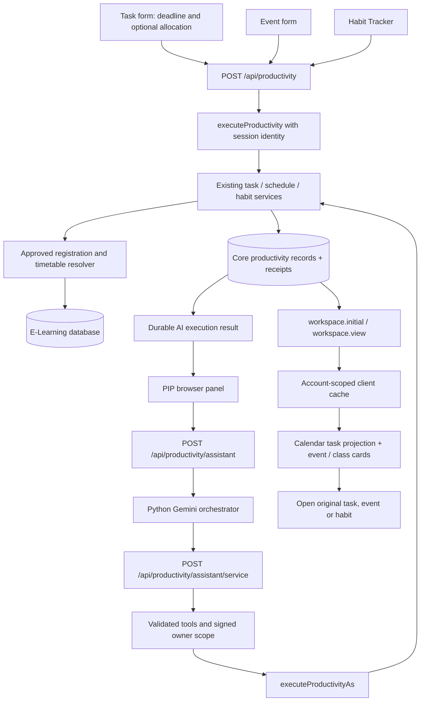

# Student portal, scheduling and PIP implementation report

This report describes the working checkout, not a production deployment claim. See [the pre-change audit](audit.md), [file catalog](files.md), [verification ledger](verification.md), and the separate [manual acceptance guide](manual-acceptance.md). Screenshots below are explicitly isolated browser fixtures, not live accounts or provider-generated success.

## 1. Executive summary

- Student workspace cards are keyboard-accessible buttons with genuine App Router transition feedback. The existing icon pulses blue for Productivity, orange for Marketplace and green for E-Learning; repeated navigation is fenced immediately. Reduced motion keeps a static indicator.
- Student Results/GPA/CGPA navigation and dashboard output are removed. The old academic-record routes redirect to the protected student dashboard; staff result workflows and academic database infrastructure remain intact.
- E-Learning has the requested **Back to Marketplace** link to the actual application hub, `/studashboard`, in full/mobile navigation and the collapsed rail. Dashboard remains `/e-learning/student/dashboard`.
- Study Zone and classroom display **Stuart**. Technical identifiers and persisted/provider contracts are preserved.
- Tasks now optionally allocate a date/start/end/timezone via `scheduledSlot` in their existing JSON data. Schedule Manager projects the source task directly, without another event or task row. A deadline remains separate.
- Calendar cards distinguish Tasks (blue), Habits (green), Events (red) and Official classes (purple), with text labels, type-aware tooltips/accessibility labels and a legend. Existing multi-card overlap lanes, overnight splitting and date navigation are retained.
- PIP has its own friendly vector robot, light blue/white interface, expandable panel, **Ask PIP** launcher, two-second ripple, secure Markdown, and backend-confirmed saved-result cards. Conversation history, voice, confirmations, reconciliation and source links remain functional.
- PIP's existing tools support task allocations and retrieving them in the schedule. Removing an allocation is confirmation-gated through `update_task`.
- No dependency, database table, physical column, migration, authorization relaxation or background job was introduced.

## 2. Audit findings

### Navigation and academic visibility

The hub used clickable divs and `router.push` without loading state or keyboard button semantics. Results and GPA/CGPA were still in the student sidebar; the dashboard queried and rendered CGPA. Academic History also exposed GPA/CGPA, so merely hiding its sibling links would have left the unwanted student output reachable. Its student presentation is now hidden along with those routes. The backend is more substantial than an empty placeholder, so deleting the services or models would have been inappropriate.

### Event failure and the previous fix

The supplied concrete failure was `1739b3ac-ce1d-4744-bd95-f105b3175fa5`: HTTP 503, Prisma `P2024`, `academic.registrations`, 10,497 ms out of 13,112 ms. The previous attempted fix requests registered courses without lecturer-name resolution while a Core write transaction is pinned. This avoids requesting another Core connection solely for display names. It preserves approved course/semester/timetable checks. Normal timetable display still resolves names, and request-local caches distinguish display and conflict reads.

That fix is retained. The phase wraps several queries, so its log does not conclusively establish which database exhausted its pool. Session-pool saturation remains a separate operational possibility. This assignment does not mask timetable failures, silently allow unverified conflicts, change credentials, or claim a successful event save for a production student. The event-save path is exercised against real local PostgreSQL, with provider-independent academic fixtures where documented.

### Productivity data and calendar

`TaskInput` previously had title/description/priority and optional deadline fields, with no working interval. Ordinary task creation could not put a block onto the calendar. Schedule Manager read events and approved classes, and task mutations did not invalidate its cache. Creating another unrelated event would have duplicated the student's work and disconnected outcomes. Existing overlap layout, midnight splitting, event history and habit occurrence identity were already useful and are preserved.

### AI interface

PIP was generically labelled and rendered persisted AI responses inside plain paragraphs, exposing Markdown syntax. Its actual implementation already includes authenticated browser routes, signed RS256 Python delegation, stored conversations, execution receipts, confirmation proposals, voice drafts and durable failure recovery. Those mechanisms are reused. The references consistently suggest light rounded surfaces, blue accents, a friendly robot, readable bubbles and a pinned composer; contradictory canned action shortcuts were omitted as explicitly requested.

## 3. Implementation details

### Portal and sidebar

`useTransition` tracks actual Next.js navigation, rather than starting a timer. A ref fences same-frame repeated clicks before React commits the pending state. All hub cards disable during that transition. Only the selected icon animates, with an accessible status message and theme colour. Completion/cancellation clears the transition indicator; remount/back navigation does not depend on a manually retained loading timer. The implementation follows the installed Next.js router documentation.

Student result entries and the empty parent group are removed. Result-related student pages authenticate and redirect; no disabled or coming-soon substitutes are added. The dashboard no longer runs its CGPA query. Existing faculty/HOD result entries remain.

### Task creation, allocation and source lifecycle

**New task → Allocate time on my schedule** exposes a scheduled date, start and end. The optional deadline above remains an intended completion deadline. Editing pre-fills the allocation in the current account timezone; clearing the checkbox removes only the allocation. Task details and audit snapshots include allocated working time.

The server independently validates the slot. It rejects invalid dates, missing/invalid timezones, malformed times, equal start/end and nonexistent local times during timezone transitions. An end before the start means the next day, matching event semantics. Existing task JSON and old audit snapshots remain valid. Ordinary task outcomes remain final, and habit task fields retain their existing edit restrictions.

Range loading includes owner-scoped scheduled tasks around the requested dates, allowing timezone conversion and overnight continuation. The renderer selects only portions touching visible dates. Task IDs are namespaced for display (`task:<id>`) but the stored ID is unchanged. Cards open the real task details. Deleted/withdrawn tasks are excluded; completed tasks retain their planned position and display their outcome. Deadline-only tasks are never assigned a guessed duration.

Legacy task-linked events are retained for compatibility when their source has no new allocation. Once the source has an allocation, its direct task card takes precedence, preventing double display. Deleted source tasks no longer contribute active legacy cards; legacy cards use current source titles, priorities and outcomes and open source task details.

### Events, overlaps and synchronization

Event saving retains title/date/time/category validation, duplicate-submit guards, owner checks, transaction receipts, explicit conflict overrides and post-confirmation UI updates. It now considers existing allocated task intervals as conflicts, in addition to personal events, event habits and official classes. No fake OfficialClass or event row is generated for this check. Smart replanning considers the same additional task commitments and searches for free time.

Creating a task with an overlap is permitted; its calendar card visibly flags the overlap. Saving a conflicting event follows the existing explicit **Keep this time** choice. No automatic overlap authorization is introduced.

Task mutations now invalidate Schedule Manager alongside task/Today views. Confirmed creates merge into relevant cached calendar ranges without a second fetch. Edits, completion, deletion and allocation removal trigger range revalidation. Existing version stamps prevent stale in-flight reads from overwriting confirmed mutations. Today also includes allocated task entries in its timetable and schedule count, including tasks whose deadline is later; legacy linked events do not double-count them.

### PIP identity, rendering and tools

The robot is a dedicated SVG asset component, not a copy of Stuart's identity and not an external image request. PIP's greeting uses the authenticated workspace name. The launcher ripples every two seconds and respects reduced motion. The panel supports closing/reopening, expansion, Escape and returning focus to the launcher. Composer focus waits for the real asynchronous conversation load rather than an arbitrary timer. Existing account scoping and drafts remain.

`react-markdown` and `remark-gfm`, already installed, render paragraphs, headings, emphasis, nested lists, blockquotes, code, task lists, tables and links for both fresh and historical messages. Raw HTML is skipped. URL handling allows HTTP(S), mailto and hash links; unsafe schemes are removed. Remote images are not loaded. External links use `noopener noreferrer`; code and tables scroll within narrow messages.

Saved cards require a completed backend execution whose projected result says `saved: true`. They link to the actual record. They do not turn assistant text, a selected tool or a pending proposal into proof of success. Confirmation/recheck controls remain; new scheduled slots and the allocation-removal choice are visible in proposal details. Refresh errors are surfaced rather than silently swallowed.

The shared tool schema accepts optional `scheduledSlot` for task create/update, and `clearSchedule` for updates. `list_schedule` uses the bounded workspace view and returns a separate bounded task collection alongside events/categories. PIP receives allocated task times as application facts. Its system instructions distinguish deadlines, work allocations and actual reminders and require missing duration/end-time clarification.

PIP remains non-streaming. No simulated token stream is added. Daily and selected-weekday habits remain the supported recurrence patterns; **every two days** and scheduled reminder delivery are not invented. The prompt explains those limits and asks for a supported alternative.

## 4. Architecture and data flow

| Actual model | Fields / relationships used |
| --- | --- |
| `ProductivityTask` | `id`, `ownerId`, `data`, optional indexed `dueDate`, scalar `outcome`, `deletedAt`, optional unique `occurrenceId`. `data.scheduledSlot` is new; `data.status` remains the source outcome. Existing owner-scoped linked event relation is retained but unused for new task allocation. |
| `ProductivityEvent` | `scheduledDate`, `data.slot`, `outcome`, `archivedAt`, owner-scoped optional `categoryId`, `linkedTaskId`, `occurrenceId`. A direct personal event remains one canonical event. |
| `ProductivityHabit` | Definition/revisions in `data`, `createdDate`, `ownerId`; owns occurrences. |
| `ProductivityOccurrence` | Unique `(habitId, originalDate)`; owner/habit relations and optional unique task/event projection. Repeated range loads do not generate another occurrence. |
| `ProductivityCategory` | Owner-scoped normalized unique name; relates to events. No new task category or colour table is introduced. |
| `ProductivityPreferences` | Account timezone, used for wall-time display and date ranges. |
| `ProductivityRequest` | Unique owner/request key, request hash and durable result, for safe mutation replay. |
| `ProductivityAIConversation`, `ProductivityAIMessage` | Owner-scoped persisted chat, sequence, active turn and lease. |
| `ProductivityAIToolExecution` | Tool name/arguments/status/result, turn/step and stable operation key. A completed mutation execution is committed with the actual productivity write. |
| `ProductivityAIPendingAction` | Proposal/target snapshot, expiry and resolved status. Browser confirmation remains mandatory where required. |

The E-Learning resolver reads current `AcademicSession`/`Semester`, approved `CourseRegistration` items, curriculum placement and approved `TimetableEntry` records. Their session data is projected into the student's timezone; official classes are read-only. No cross-database foreign key or duplicated academic source is introduced.

Creating a task writes one ProductivityTask plus its request receipt. Reading a visible range projects that task's optional working interval directly. Creating an event writes one ProductivityEvent after validation and conflict checks. Recurring habits retain their existing definition → occurrence → task/event identity chain. Updates/deletions revalidate the affected client ranges; completion is never guessed from elapsed time.

## 5. Files modified

See the complete [categorized file-by-file catalog](files.md). It distinguishes this assignment's edits from the pre-existing uncommitted revision-signature and event-diagnostic changes. No inspected-only file is counted as modified, and no generated Prisma client is edited manually.

## 6. Database and API transparency

- **Physical schema/migrations/indexes:** none. No table, column, foreign key, database name or persistent enum changed. No reset or production test data was created.
- **Additive JSON:** optional `TaskInput.scheduledSlot = { date, start, end, timezone }`, also retained in task audit snapshots and projected AI task results. Existing storage version 2 and legacy version-1 conversion remain.
- **Existing API operations:** `tasks.create`/`tasks.update` accept the optional allocation through the same authenticated `POST /api/productivity`. Existing workspace reads now include allocated tasks in their source task dataset; the response envelope is unchanged.
- **Existing PIP tools:** task create/update schema adds `scheduledSlot`; update changes add `clearSchedule`; `list_schedule` adds a bounded `tasks` collection. Browser/API route names and Python callback envelopes remain unchanged.
- **Authorization:** unchanged. Owner identity is session/delegation derived, not taken from model or form fields. Existing origin checks, role checks, owner-row locks, scoped foreign keys and receipt replay remain.
- **Routing visibility:** student result pages now redirect. This is not deletion of result services or staff APIs.
- **Background work:** no cron, reminder pipeline, notification provider or new job added. Existing save notices and habit generation remain.

## 7. Automated verification

See [verification.md](verification.md) for commands, selection reasons, counts, initial failures, their resolutions and verification limits. The selected tests target the changed task lifecycle/cache, event persistence and conflicts, AI tools/confirmations, rendering/security, navigation and responsive layouts. They do not claim live Gemini or microphone-provider verification.

## 8. Production readiness

The implementation uses existing Next.js/React/Prisma and Markdown dependencies and generates both Prisma clients through the project's normal build. No migration sequencing is necessary. Both the Next.js application and the separate Python service need the updated shared tool definitions and PIP prompt when this feature set is deployed. A successful build is evidence of integration, not proof of a live student journey or live provider access.

**This feature set has not been deployed by this assignment.** Earlier timestamp/event fixes were separately deployed in the preceding work. Local acceptance should precede publishing this broader change. Current production session-pool configuration was not changed here, and the original student's successful event creation still needs production verification.

## 9. Outstanding issues and boundaries

1. Full repository lint has three reproducible pre-existing errors in browser fixtures, plus warnings. Relevant new-code errors discovered during targeted lint were repaired; the baseline failures are documented separately.
2. Production connection-pool capacity/session-vs-transaction configuration can still cause timetable failures. The application continues to fail honestly rather than claiming conflict checks succeeded.
3. Live Gemini generation, AssemblyAI microphone permissions/transcription and production persistence were not verified by fixture tests. The manual checklist identifies those dependencies.
4. Streaming, every-N-day habit recurrence, delivered reminders and ordinary personal-event completion controls are not supported features of the existing system. No UI promises them.
5. Event removal uses existing archive/restore, not a new destructive delete endpoint. Ordinary tasks use existing soft deletion.
6. Date-only tasks stay in To-do List. Focus Mode remains for explicit must-complete events; allocated tasks appear in the combined schedule with Focus Mode off.
7. The owner-filtered JSON date-range lookup uses existing indexes; no dedicated scheduledSlot index or production high-volume benchmark is claimed.

## 10. Manual acceptance

Begin at `/studashboard` in this checkout's running application, signed in as an ordinary student using local/staging data. Follow [manual-acceptance.md](manual-acceptance.md) in order. Start with **A01**, then **D01–D07** and **E01–F07** before live PIP tests. Every case specifies setup, exact steps, expected behavior, failure indicators and priority.

Fixture previews: [PIP desktop](screenshots/pip-desktop.png), [PIP tablet](screenshots/pip-tablet.png), [PIP mobile](screenshots/pip-mobile.png), [schedule desktop](screenshots/schedule-desktop.png), [schedule mobile](screenshots/schedule-mobile.png), [portal Marketplace loading](screenshots/portal-marketplace.png). These are browser component fixtures, not production accounts.
